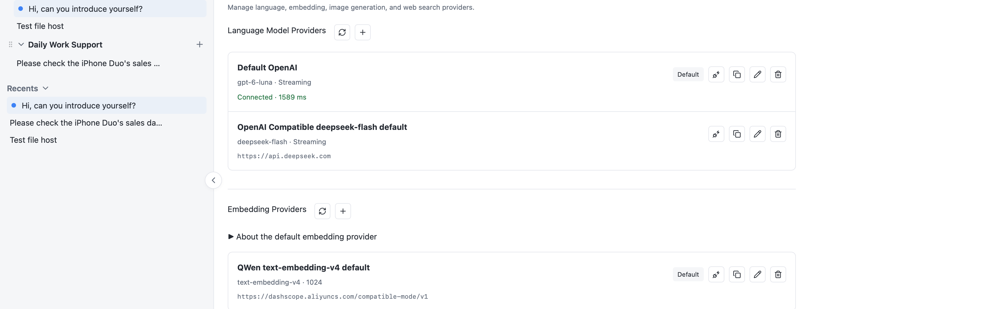
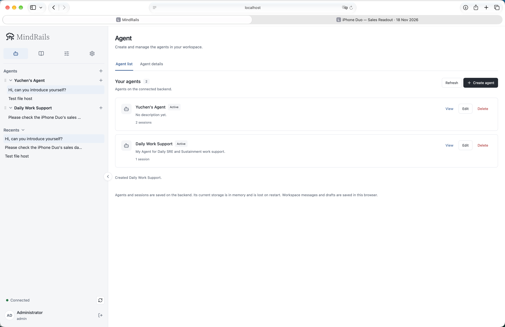
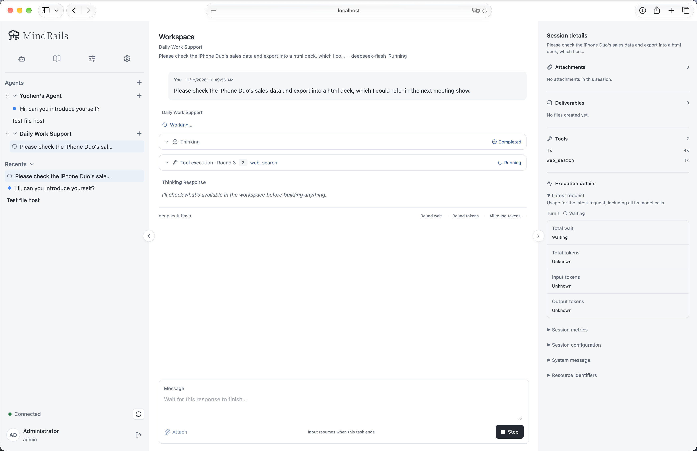
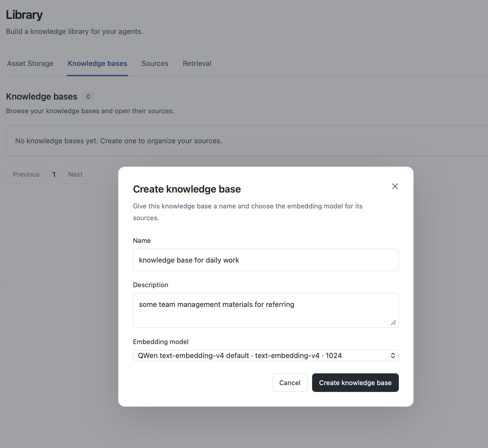
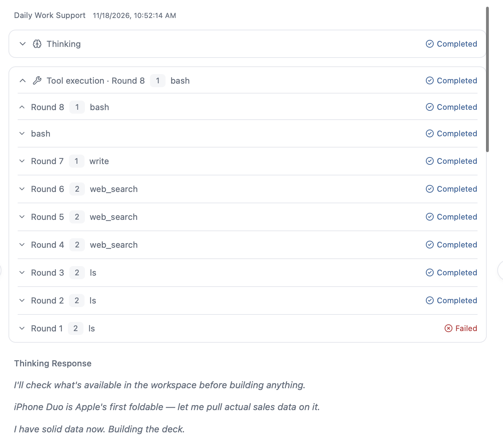
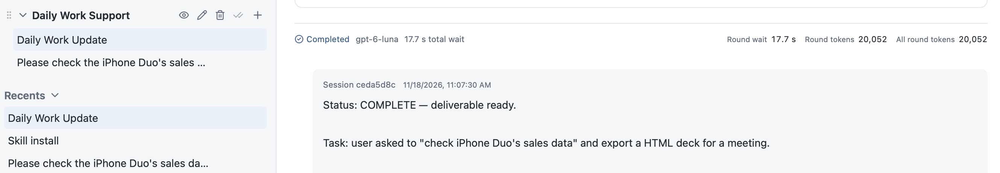
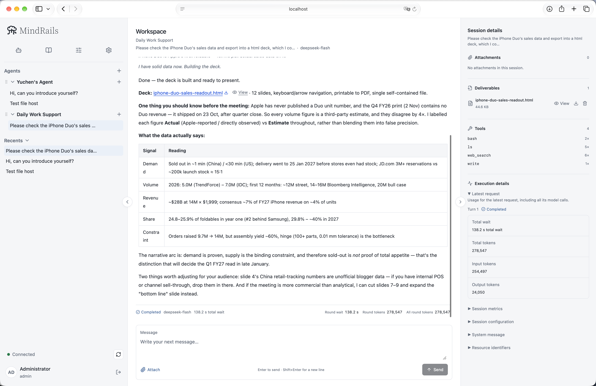
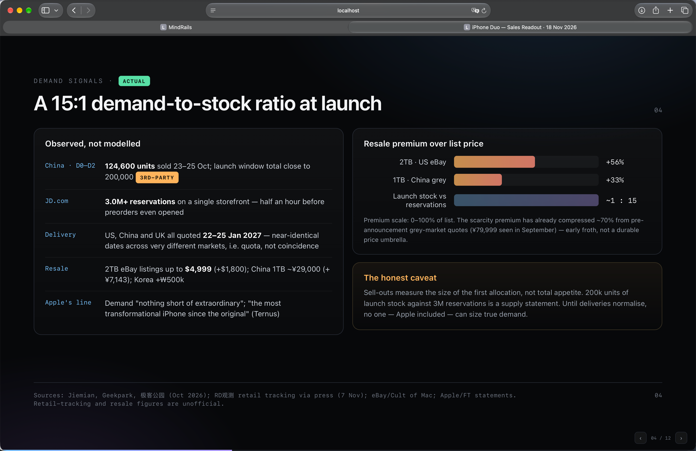
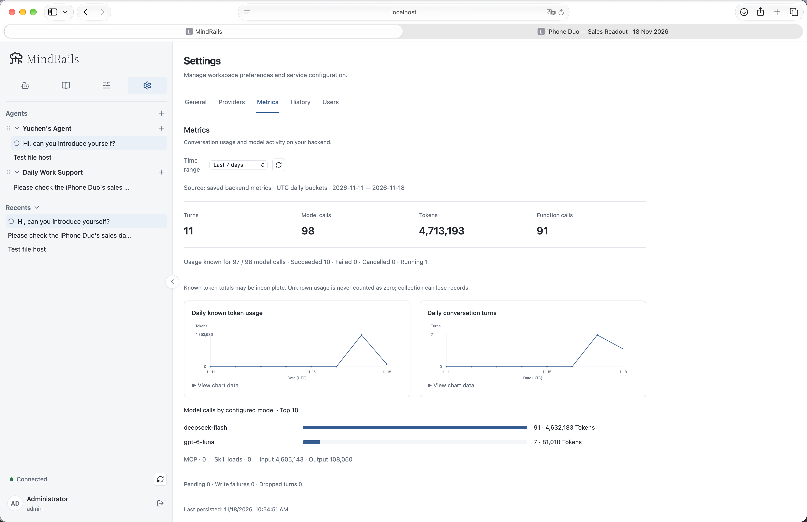

# 使用 MindRails

[English](Introduction.md)

MindRails 让团队成员通过浏览器使用 Agent。桌面 Agent 通常需要每个人在自己的电脑上安装；MindRails 由一位 IT 管理员部署、接入模型并开通账号。任务在服务器上执行，用户换一台电脑也能继续自己的会话。

团队共用一套服务，可省去重复部署。对话模型随任务选，嵌入模型按资料选。管理员可以根据实际用量判断哪些任务适合换用更便宜的模型。团队也可以按 MIT 许可修改平台。

## 为团队开通服务

在 **Settings → Providers** 添加对话模型，测试连接并设为默认。可选兼容 OpenAI 的对话端点、Anthropic 和 Google Gemini 等。需要按语义检索文档时，再添加嵌入服务。

在[用户管理](images/users.png)中为同事分别开通账号。每个人可以选择[工作区主题](images/themes.png)，管理自己的 Agent。

## 把固定职责交给 Agent

例如，要定期做销售复盘，可以创建一个调研 Agent。写下目标和长期指令，例如“每个数字都要标明出处”。每期复盘新开一个会话，把相关问题、来源和文件放在一起。

在工作区选择 Agent，提出问题并附上最新记录。之后从侧栏打开同一会话，就能继续追问。

## 让回答有据可查

在 **Library** 中为产品资料、往期报告等常用文档创建知识库。选好嵌入模型，上传文档，再将知识库分配给 Agent。索引完成后就可以提问，并打开引用段落核对回答。支持 Markdown、文本型 PDF、DOCX 和 PPTX 等格式。

## 查看任务执行过程

展开工具调用，可以看到 Agent 搜了什么、读了什么、返回了什么，以及哪一步失败。要快速了解一次请求的开销，可在会话详情查看用过的工具、总等待时间和 Token 数。

可对照查看[展开的工具结果](images/thinking-tool-invoke.png)和[请求用量摘要](images/session_details.png)。

### 复用工作流程，接入外部服务

**技能**让 Agent 复用你的做法。把复盘清单写入 `SKILL.md`，和报告模板一起打包，在 **Customize → Skills** 上传 ZIP。下次复盘时，Agent 就能加载清单和模板。你也可以在会话中直接让它创建技能。

**MCP** 让 Agent 调用其他服务的工具。例如，工单系统提供了 MCP 服务，就可以在 **Customize → MCP** 注册、测试连接并查看工具。Agent 随后便能用其中的查询工具为复盘查找工单。

### 让会话互通进展

同一账号下，一个会话可以负责调研，另一个负责编写工作简报。写简报的 Agent 可以向调研会话询问进度。图中的调研会话已回复，确认会议演示文稿已经完成。

## 把回答变成交付物

先阅读 [Markdown 草稿](images/markdown-support.png)，核对来源并提出修改。定稿后，让 Agent 生成自包含的 HTML 演示文稿。在会话的 **Deliverables** 中可以预览或下载文件。

在托管视图中打开[封面](images/hosting.png)，即可逐页浏览。下图是示例报告中的一页数据分析。

## 查看模型用量

在 **Settings → Metrics** 选择时间范围，可查看对话轮数、模型调用、Token 和工具调用。一次对话可能触发多次模型调用，按模型查看即可找出 Token 用量最高的模型。

部署和开发步骤见 [README](README.cn.md)。

MindRails 处于 MVP 阶段。欢迎来信讨论：[yuchen.zhang.mail@gmail.com](mailto:yuchen.zhang.mail@gmail.com)。

[LICENSE](LICENSE) — 本仓库采用 MIT 许可证。
