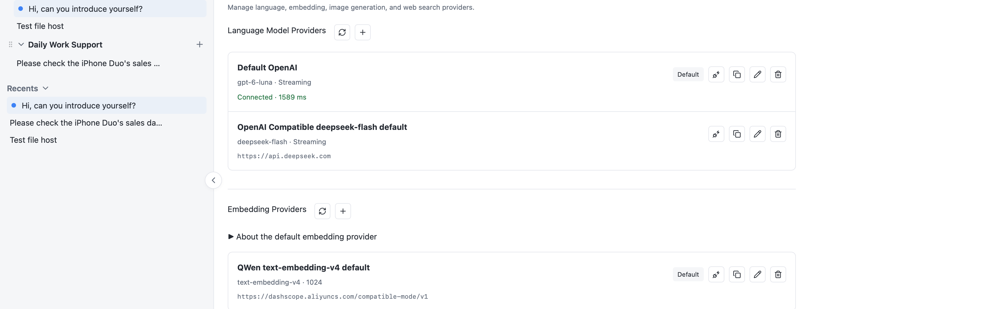
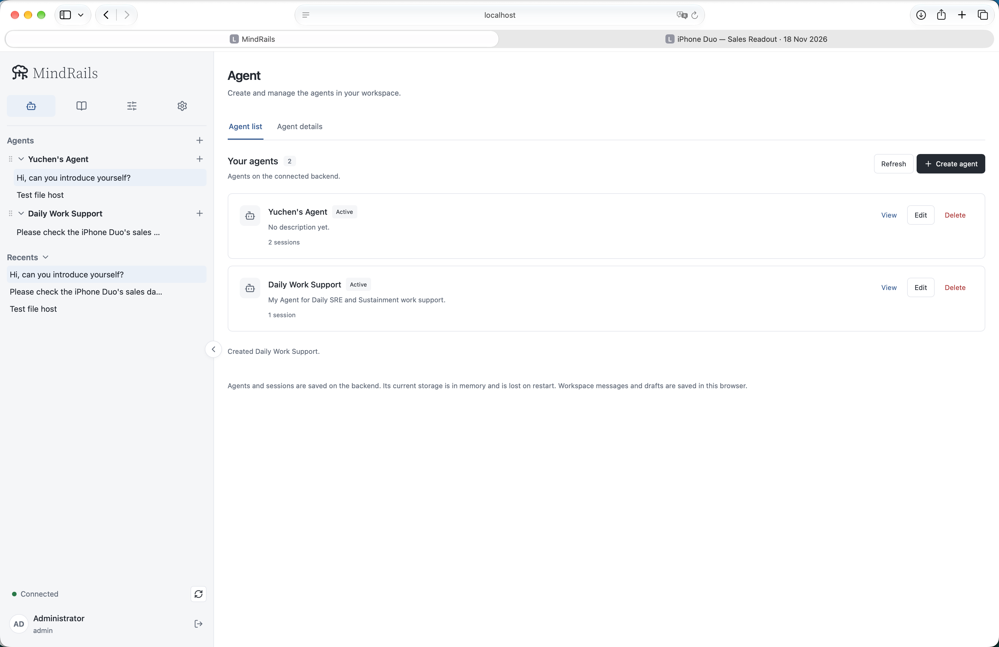
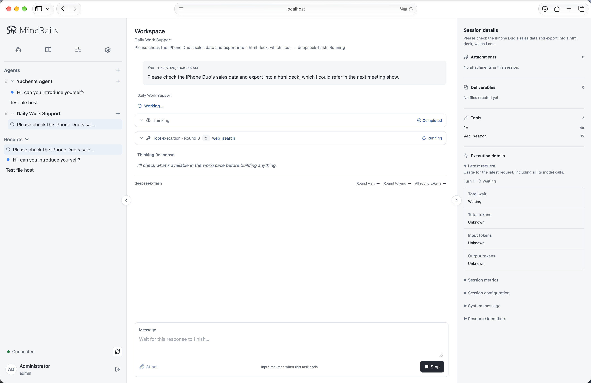
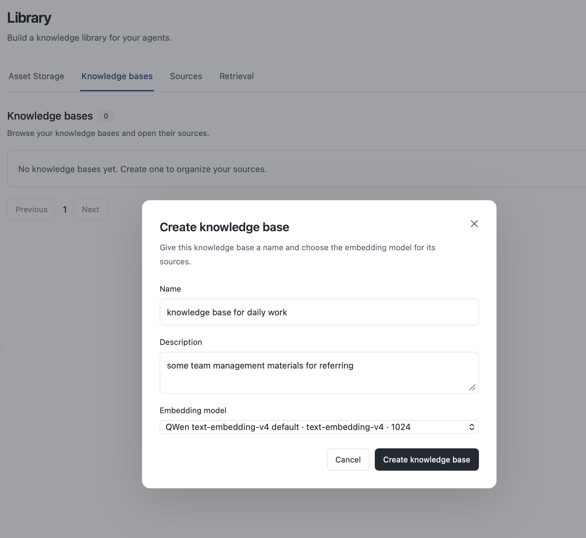
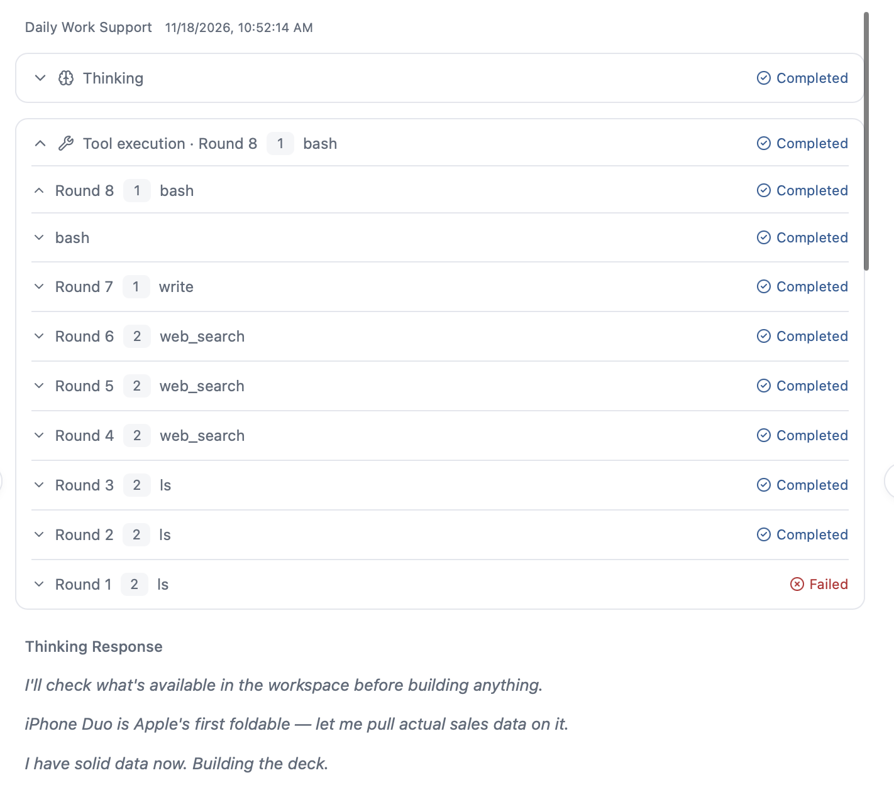
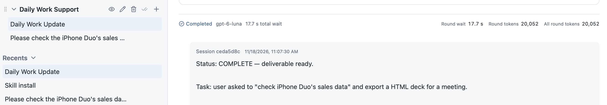
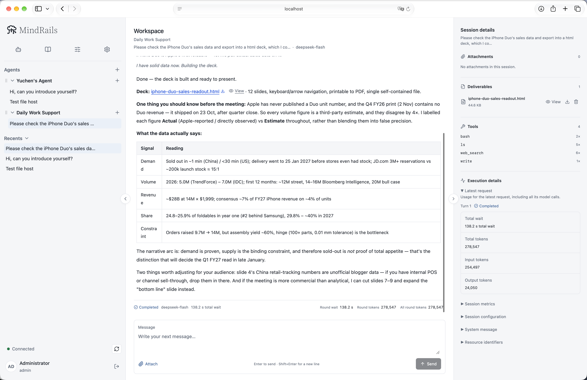
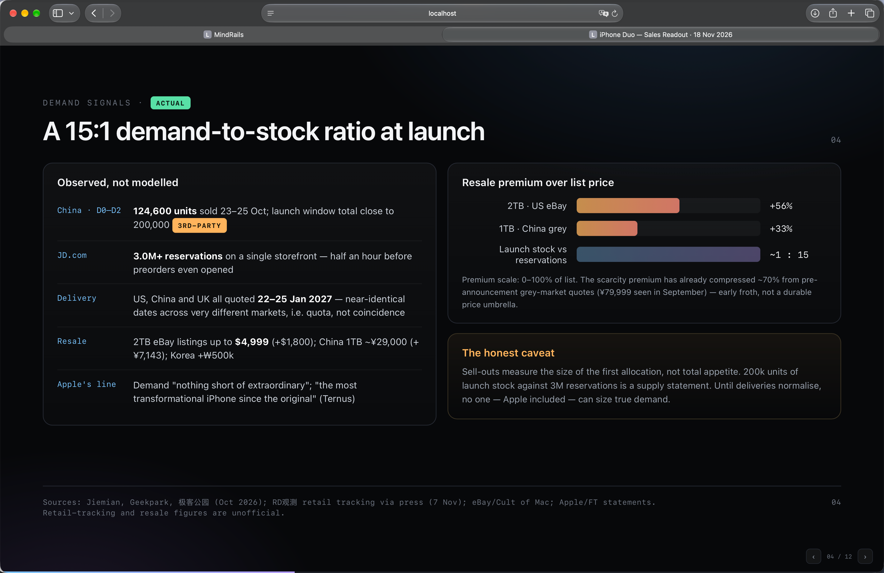
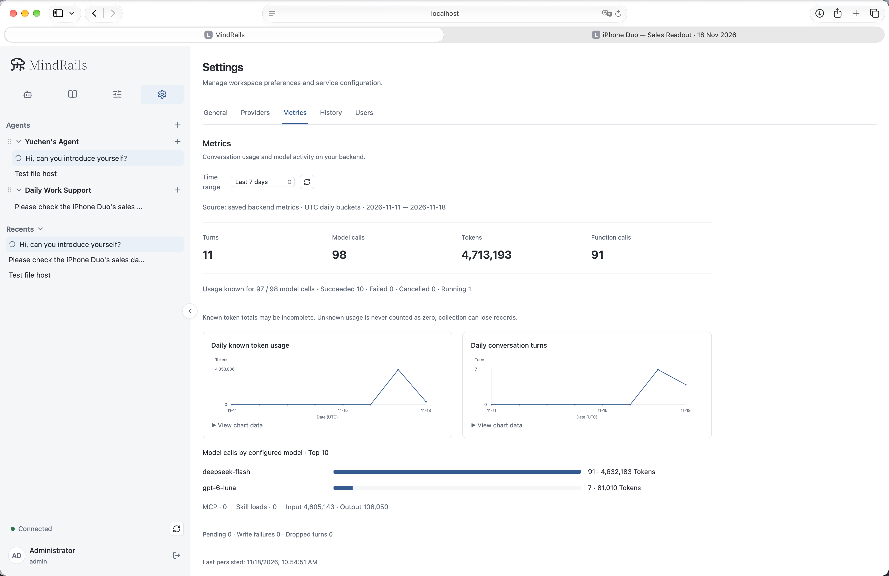

# Working with MindRails

[简体中文](Introduction.cn.md)

MindRails brings agents to the team’s browser. One IT administrator runs the service, connects providers and creates accounts. Unlike a desktop agent installed on each colleague’s machine, MindRails runs tasks on the server. Users can pick up their own sessions from another computer.

Share one installation to reduce setup work. Choose a chat model for each task and an embedding model for your documents. Track usage to see where a cheaper model might suffice. The MIT license lets you adapt the platform to your team.

## Set up the team

In **Settings → Providers**, add a chat model, test the connection and select a default. Supported options include OpenAI-compatible chat endpoints, Anthropic and Google Gemini. Add an embedding provider when you want to search documents by meaning.

Create an account for each colleague in [user management](images/users.png). Each person can choose a [workspace theme](images/themes.png) and manage their own agents.

## Give an agent a recurring job

For a weekly sales review, create a research agent. Give it a goal and standing instructions, such as “cite a source for every figure.” Start a new session for each review to keep its questions, sources and files together.

In the workspace, select the agent, ask a question and attach the latest notes. Reopen the session from the sidebar to ask a follow-up.

## Give answers a source

In **Library**, create a knowledge base for recurring reference material, such as product notes and past reports. Choose an embedding model, upload documents and assign the collection to the agent. Once indexing finishes, ask a question and open the cited passage to check the answer. Supported formats include Markdown, text-based PDF, DOCX and PPTX.

## Follow the work

Expand a tool call to see what the agent searched or read, what came back and which step failed. For a quick review, the session details panel lists the tools used, total wait time and token counts for the latest request.

Compare the [expanded tool result](images/thinking-tool-invoke.png) with the [request summary](images/session_details.png).

### Reuse a workflow or connect another service

**Skills** teach an agent your procedure. Put the review checklist in `SKILL.md`, bundle it with a report template and upload the ZIP under **Customize → Skills**. The agent can load the checklist and template for the next review. You can also ask it to create a skill during a session.

**MCP** gives an agent tools from another service. If your issue tracker exposes an MCP server, register it in **Customize → MCP**, test the connection and inspect its tools. The agent can then use the available tools to look up issues for the review.

### Pass findings between sessions

Keep a research session and a reporting session under your account. The reporting agent can ask the research session for an update. In the example, the research session confirms that the meeting deck is ready.

## Turn the answer into a deliverable

Read the [Markdown draft](images/markdown-support.png), check the sources and ask for changes. When it is ready, ask for a self-contained HTML slide deck. The session lists the file under **Deliverables** for preview or download.

Open the [title slide](images/hosting.png) in the hosted viewer and page through the presentation. Here is a data slide from the example report.

## Check model usage

In **Settings → Metrics**, choose a time range to see conversation turns, model calls, tokens and tool calls. A single turn can involve several model calls. Use the model breakdown to see which model accounts for the most tokens.

For setup instructions, see the [README](README.md).

MindRails is in MVP. Send questions or feedback to [yuchen.zhang.mail@gmail.com](mailto:yuchen.zhang.mail@gmail.com).

[LICENSE](LICENSE) — MIT license for this repository.
